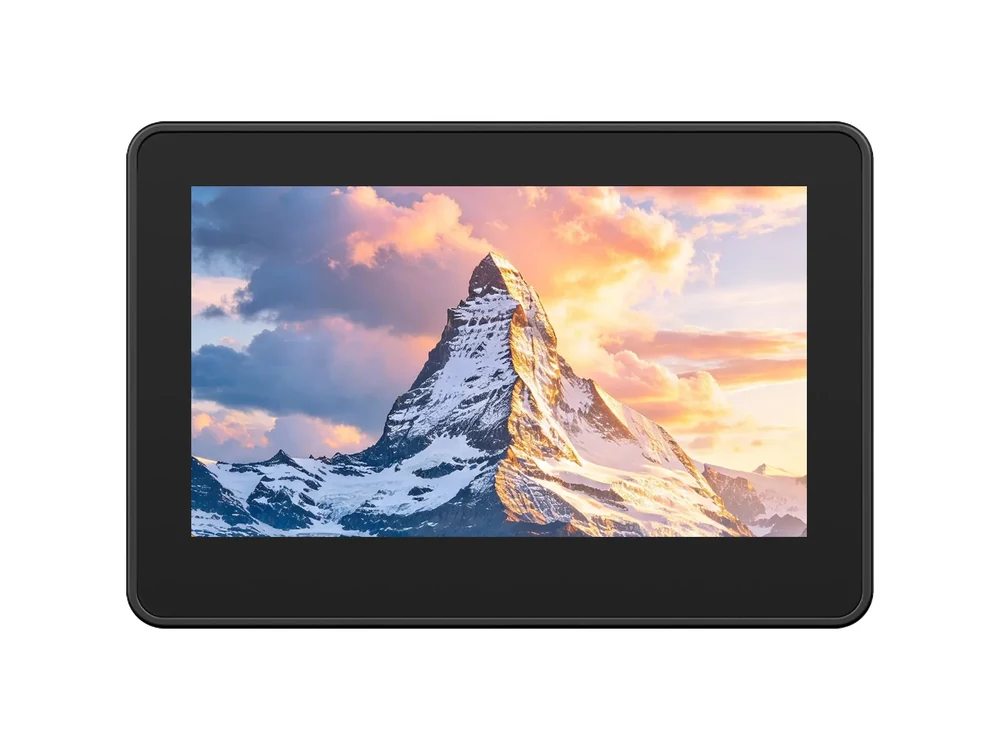

  <h1>ESP32-S31-Touch-LCD-4.3C</h1>
  
<strong>ESP32-S31 4.3-inch 800 × 480 RGB capacitive touch development board</strong>

  
<strong>English</strong> | <a href="README_ZH.md">简体中文</a>

  

    
    
    
  

  

    <a href="https://www.waveshare.net/shop/ESP32-S31-Touch-LCD-4.3C.htm">🌐 Product</a> &middot;
    <a href="https://github.com/waveshareteam/ESP32-S31-Touch-LCD-4.3C/releases/latest">📦 Firmware</a> &middot;
    <a href="examples/esp-idf/">🧩 ESP-IDF</a> &middot;
    <a href="hardware/">📚 Documentation</a>
  

  

---

## ✨ Overview

This board combines a 4.3-inch touchscreen, dual microphones, audio output, motion sensing, battery monitoring, TF storage, RTC and industrial interfaces for HMI and peripheral applications. This repository provides 16 ESP-IDF examples, firmware and hardware resources.

| Feature | Device / interface |
| --- | --- |
| MCU | ESP32-S31, dual-core RISC-V, up to 320 MHz |
| Memory | 16 MB Flash, 16 MB PSRAM; ESP32-S31-WROOM-3-N16R16 module |
| Display | 4.3-inch, 800 × 480, 16-bit RGB565 |
| Touch | GT911, I2C capacitive touch |
| Audio | ES8389, dual microphones and speaker amplifier |
| Sensors | QMI8658 IMU, BQ27220 battery gauge, PCF85063ATL RTC |
| Peripherals | 4-bit SDMMC TF card, RS485, CAN-FD, USB Host |
| Board support | Managed waveshare/waveshare_boards component |

## 📦 Quick Start

1. Download your example’s firmware ZIP from the [latest release](https://github.com/waveshareteam/ESP32-S31-Touch-LCD-4.3C/releases/latest).
2. Extract it and prepare an esptool environment that supports esp32s31.
3. Connect the board over USB.
4. In Bash run `./flash_combined.sh PORT`, or in Windows PowerShell run `.\flash_combined.bat PORT`, replacing PORT with the device port.
5. Reset the board if needed and connect peripherals as described in the selected example.

Factory firmware: download the file with `FactoryOnly` in its name from the [firmware](firmware/) directory.

## 🧪 Examples

### ESP-IDF

| Example | Main feature |
| --- | --- |
| [01_i2c_scan](examples/esp-idf/01_i2c_scan/) | I2C bus scan |
| [02_rtc_pcf85063atl](examples/esp-idf/02_rtc_pcf85063atl/) | RTC time and interrupts |
| [03_imu_qmi8658](examples/esp-idf/03_imu_qmi8658/) | Accelerometer and gyroscope |
| [04_bat_bq27220](examples/esp-idf/04_bat_bq27220/) | Battery monitoring |
| [05_tf_card](examples/esp-idf/05_tf_card/) | 4-bit SDMMC file test |
| [06_codec_mic_raw](examples/esp-idf/06_codec_mic_raw/) | Stereo microphone samples |
| [07_codec_sd_wav_player](examples/esp-idf/07_codec_sd_wav_player/) | TF-card WAV playback |
| [08_rs485](examples/esp-idf/08_rs485/) | Half-duplex RS485 |
| [09_canfd](examples/esp-idf/09_canfd/) | CAN-FD transmit and receive |
| [10_usb_host](examples/esp-idf/10_usb_host/) | USB device enumeration |
| [11_rgb_lcd](examples/esp-idf/11_rgb_lcd/) | RGB LCD test patterns |
| [12_touch](examples/esp-idf/12_touch/) | GT911 touch drawing |
| [13_comprehensive_test](examples/esp-idf/13_comprehensive_test/) | Integrated peripheral dashboard |
| [14_lvgl_porting](examples/esp-idf/14_lvgl_porting/) | LVGL display and touch |
| [15_bluetooth_speaker](examples/esp-idf/15_bluetooth_speaker/) | Bluetooth A2DP speaker |
| [16_usb_camera](examples/esp-idf/16_usb_camera/) | External USB UVC camera preview |

## 🛠️ Development Environment

| Framework | Version | Examples |
| --- | --- | ---: |
| ESP-IDF | v6.1 | 16 |

For source builds, follow the [ESP-IDF instructions](examples/esp-idf/README.md#build-and-flash); resolve managed dependencies and generate the board configuration before the first build.

## 📚 Resources

- [Schematic](hardware/schematic/)
- [Mechanical reference drawings and 3D model](hardware/mechanical/) (supplied files are for the ESP32-S3 model)
- [Board definition and pin configuration](https://github.com/waveshareteam/waveshare_boards/tree/v0.1.5/boards/esp32_s31_touch_lcd_4_3c)
- [Product page](https://www.waveshare.net/shop/ESP32-S31-Touch-LCD-4.3C.htm)

## 🤝 Support

- Example or repository problems: [open an issue](https://github.com/waveshareteam/ESP32-S31-Touch-LCD-4.3C/issues/new/choose).
- Product usage, hardware or order questions: [Waveshare support](https://service.waveshare.com/).

## 📄 License

Apache License 2.0 unless otherwise stated for third-party content. See [LICENSE](LICENSE).
