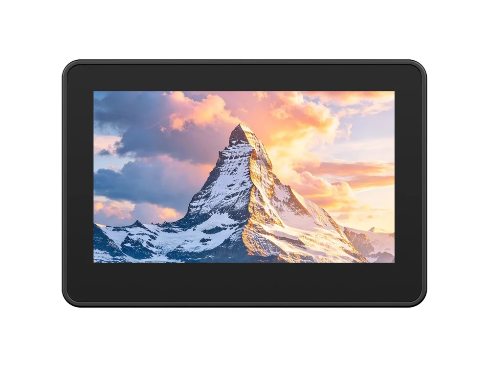

# 微雪 ESP32-S31-Touch-LCD-4.3C

[English](README.md)

**ESP32-S31-Touch-LCD-4.3C** 是一款基于 ESP32-S31 的 4.3 英寸人机交互开发板，集成 800 x 480 电容触摸屏、音频、运动传感器、电池监测、TF 卡、RTC、RS485、CAN-FD 和 USB Host 等功能。

本仓库提供 ESP-IDF 示例、硬件图纸以及一份全 Flash 测试固件。示例通过托管组件加载板级定义。



## 硬件概览

| 功能 | 硬件 |
| --- | --- |
| 主控 | ESP32-S31，双核 RISC-V，最高 320 MHz |
| 显示 | 4.3 英寸，800 x 480，16 位 RGB565 接口 |
| 触摸 | GT911 电容触摸控制器 |
| 音频 | ES8389 编解码器、麦克风输入和扬声器功放 |
| 存储 | SDMMC 接口 TF 卡 |
| 传感器 | QMI8658 IMU、BQ27220 电量计 |
| 时钟 | PCF85063ATL RTC |
| 工业接口 | 半双工 RS485、CAN-FD |
| 扩展 | USB Host 和板载扩展连接器 |

经核对的引脚表、I2C 地址和资料来源见[硬件参考](HARDWARE_REFERENCE_ZH.md)，原理图与 CAD 文件位于 [`hardware/`](hardware/) 目录。

## 软件支持

仓库目前包含 **16 个 ESP-IDF 工程**，不包含 Arduino 示例。请使用支持 `esp32s31` 目标的 ESP-IDF 版本；当前示例的组件清单要求 ESP-IDF `>=6.2`。

选择框架版本前，请先查看乐鑫官方的 [ESP32-S31 支持状态](https://developer.espressif.com/hardware/esp32s31/)。ESP-IDF 5.5、6.0 稳定版以及当前稳定版 Arduino-ESP32 均未提供 ESP32-S31 构建目标，因此本仓库不宣称支持这些版本。

### 编译示例

安装并导出兼容的 ESP-IDF 环境，然后在任一示例目录执行：

首次构建前，请按[组件准备说明](docs/components.md#prepare-the-board-definition)解析托管依赖并生成板级配置。发布的组件包需已包含 `esp32_s31_touch_lcd_4_3c`。

```text
cd examples/esp-idf/01_i2c_scan
idf.py set-target esp32s31
idf.py bmgr -b esp32_s31_touch_lcd_4_3c
idf.py build
idf.py -p PORT flash monitor
```

请将 `PORT` 替换为开发板串口。`idf.py bmgr` 会读取托管组件中的 `esp32_s31_touch_lcd_4_3c` 板级定义并生成 Board Manager 初始化组件。每个示例的具体行为和硬件要求见对应 README。

## 示例

| 序号 | 示例 | 功能 |
| ---: | --- | --- |
| 1 | [`01_i2c_scan`](examples/esp-idf/01_i2c_scan/) | 扫描板载 I2C 总线 |
| 2 | [`02_rtc_pcf85063atl`](examples/esp-idf/02_rtc_pcf85063atl/) | 读写 RTC |
| 3 | [`03_imu_qmi8658`](examples/esp-idf/03_imu_qmi8658/) | 读取加速度计和陀螺仪数据 |
| 4 | [`04_bat_bq27220`](examples/esp-idf/04_bat_bq27220/) | 读取电量计信息 |
| 5 | [`05_tf_card`](examples/esp-idf/05_tf_card/) | 挂载并访问 TF 卡 |
| 6 | [`06_codec_mic_raw`](examples/esp-idf/06_codec_mic_raw/) | 通过 ES8389 采集麦克风原始数据 |
| 7 | [`07_codec_sd_wav_player`](examples/esp-idf/07_codec_sd_wav_player/) | 播放 TF 卡中的 WAV 文件 |
| 8 | [`08_rs485`](examples/esp-idf/08_rs485/) | 测试半双工 RS485 接口 |
| 9 | [`09_canfd`](examples/esp-idf/09_canfd/) | 收发 CAN-FD 帧 |
| 10 | [`10_usb_host`](examples/esp-idf/10_usb_host/) | 枚举外部 USB 设备 |
| 11 | [`11_rgb_lcd`](examples/esp-idf/11_rgb_lcd/) | 驱动 800 x 480 RGB LCD |
| 12 | [`12_touch`](examples/esp-idf/12_touch/) | 读取 GT911 触摸输入 |
| 13 | [`13_comprehensive_test`](examples/esp-idf/13_comprehensive_test/) | 综合测试板载外设 |
| 14 | [`14_lvgl_porting`](examples/esp-idf/14_lvgl_porting/) | 运行 LVGL 显示与触摸示例 |
| 15 | [`15_bluetooth_speaker`](examples/esp-idf/15_bluetooth_speaker/) | 接收蓝牙 A2DP 音频并显示 LVGL 播放界面 |
| 16 | [`16_usb_camera`](examples/esp-idf/16_usb_camera/) | 显示外接 USB UVC 摄像头画面 |

USB 摄像头示例不代表板上集成摄像头；本板没有 DVP 摄像头接口。实现细节和迁移说明见 [ESP-IDF 示例索引](examples/esp-idf/README.md)。

## 测试固件

[`firmware/ESP32-S31-Touch-LCD-4.3C-Test.bin`](firmware/ESP32-S31-Touch-LCD-4.3C-Test.bin) 是仓库随附的 16 MB **全 Flash 测试镜像**。全 Flash 镜像会覆盖目标 Flash 内容，烧录前请先阅读 [`firmware/README.md`](firmware/README.md)。

## 固件版本与 Releases

向 GitHub 推送 `v主版本.次版本.补丁版本` 格式的附注标签后，自动编译全部 16 个示例，校验固件包，再发布包含 16 个 ZIP 和 `SHA256SUMS` 的 Release。Release 按正式版本发布并标记为 **Latest**。ESP32-S31 使用 [`releases/config.json`](releases/config.json) 中固定的工具链。

分支和 PR 构建上传 Actions 附件；手动运行可选择单个示例，不会发布 Release。操作步骤见[发布说明](releases/README_ZH.md)。

## 仓库结构

```text
docs/                仓库、组件、CI 和固件说明
docs/images/         产品图片
examples/esp-idf/    独立 ESP-IDF 工程
firmware/            随仓库提供的全 Flash 测试镜像
hardware/            原理图和机械文件
releases/            源码构建固件的打包工具
scripts/             示例发现与仓库检查脚本
```

更多文档：

- [仓库结构](docs/repository-structure.md)
- [组件布局](docs/components.md)
- [固件说明](docs/firmware.md)
- [CI 范围](docs/ci.md)
- [编译验证记录](docs/validation.md)
- [参与贡献](CONTRIBUTING.md)
- [技术支持](SUPPORT.md)
- [安全策略](SECURITY.md)

## 许可证

除非子目录或第三方组件另有说明，本仓库按 [Apache License 2.0](LICENSE) 发布。仓库中包含的第三方组件和媒体文件保留各自的许可证声明。
